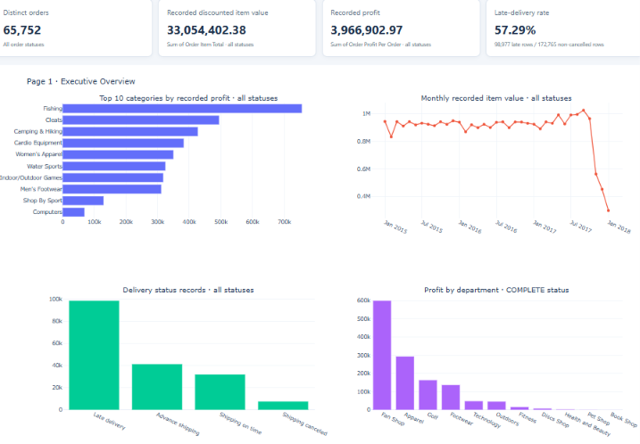
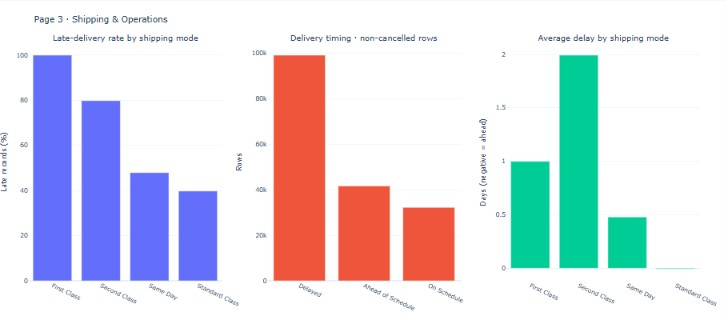

# Global Supply Chain & Inventory Intelligence

An end-to-end data analytics project analyzing supply chain operations, product profitability, sales performance, and delivery efficiency using Python, SQL, and interactive dashboards.

## 📊 Dashboard Previews

### 1. Executive Overview


### 2. Product Profitability


### 3. Shipping & Operations


## 🚀 Live Interactive Dashboard

[View the Interactive Dashboard](https://swethaa1402.github.io/Global-Supply-Chain-Inventory-Intelligence/)

## 🛠️ Tools & Technologies

- **Python:** Data cleaning, preprocessing, and exploratory data analysis
- **SQL / MySQL:** KPI calculations, delivery performance analysis, and business queries
- **Interactive HTML Dashboards:** Visual exploration of key business metrics
- **GitHub Pages:** Dashboard publishing

## 📈 Project Objectives

- Analyze overall sales and order performance.
- Evaluate product profitability and category performance.
- Investigate delivery delays and shipping-mode performance.
- Identify operational trends and potential improvement areas.
- Document data-quality limitations to support responsible interpretation.

## 🔍 Key Findings

- The dataset contains approximately 180,519 records.
- Delivery performance analysis identified a high proportion of late-delivery records among non-cancelled rows.
- First Class shipping showed a particularly high late-delivery rate in this dataset.
- The dataset contains structural changes over time that may affect comparisons and interpretations.

*Findings describe this dataset and should not be interpreted as proof of the causes of operational issues.*

## 🗂️ Project Structure

```text
Global-Supply-Chain-Inventory-Intelligence/
├── documents/
│   ├── DATA_DICTIONARY.md
│   └── PROJECT_METHODOLOGY.md
├── images/
│   ├── 01_Executive_Overview.png
│   ├── 02_Product_Profitability.png
│   └── 03_Shipping_Operations.png
├── powerbi/
│   └── README.txt
├── python/
│   └── Data analysis and processing scripts
├── reports/
│   └── Interactive HTML report
├── sql/
│   ├── 01_executive_kpis.sql
│   ├── 02_delivery_performance.sql
│   └── 03_completed_orders.sql
└── README.md
```

## 🧹 Data Processing

The project includes data inspection, quality checks, cleaning, exploratory analysis, SQL-based KPI calculations, and delivery-performance analysis.

## ⚠️ Data Limitations

The dataset shows structural changes during the observed period. These changes may influence order-level and time-based comparisons. Results should be interpreted in the context of the available data, and correlations should not be treated as causal explanations.

## 👩‍💻 Author

**Swethaa K**

- GitHub: [Swethaa1402](https://github.com/Swethaa1402)
- Project Repository: [Global Supply Chain & Inventory Intelligence](https://github.com/Swethaa1402/Global-Supply-Chain-Inventory-Intelligence)
- Live Dashboard: [Explore the dashboard](https://swethaa1402.github.io/Global-Supply-Chain-Inventory-Intelligence/)